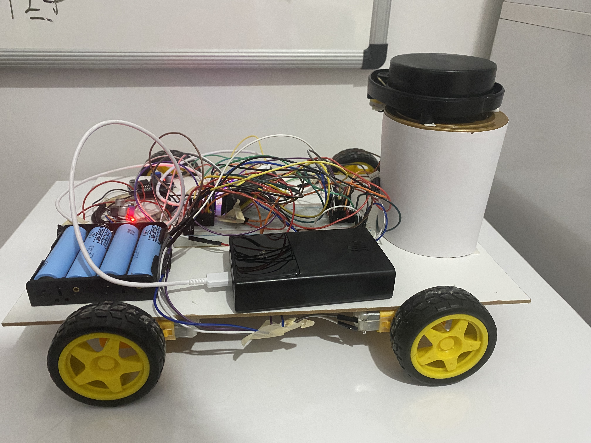
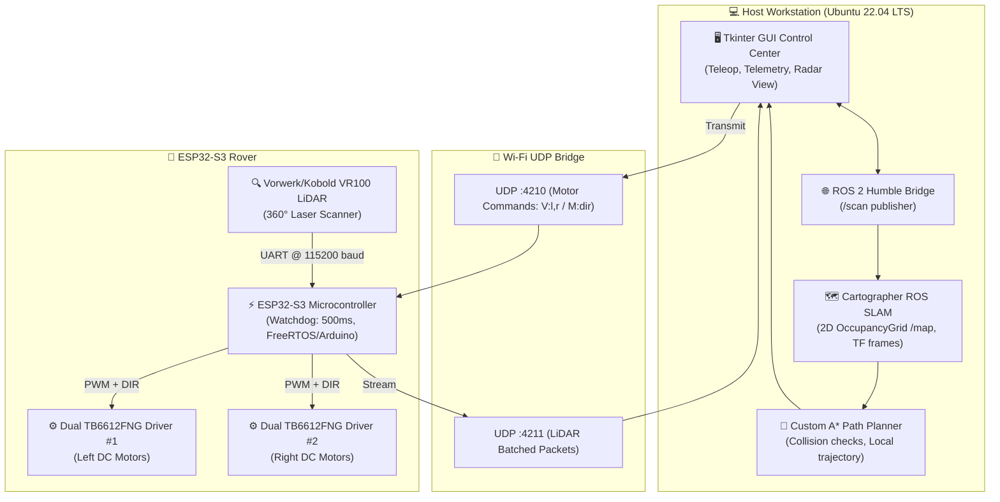

<div align="center">

# 🤖 ESP32-S3 Autonomous Rover

### 4WD Ground Robot with Real-Time LiDAR SLAM, Cartographer ROS 2 & Custom A* Navigation

[](https://docs.ros.org/en/humble/)
[](https://www.espressif.com/)
[](https://www.python.org/)
[](https://www.arduino.cc/)
[](https://ubuntu.com/)
[](LICENSE)

<br/>



<p align="center">
  <b>An end-to-end autonomous robotics project:</b> From low-level C++ motor control & high-speed UDP LiDAR streaming on an ESP32-S3 to 2D Cartographer mapping and autonomous A* path planning via a custom Python GUI.
</p>

[Key Features](#-key-features) •
[System Architecture](#-system-architecture) •
[Hardware & Pinout](#-hardware--pinout) •
[Quick Start](#-quick-start) •
[GUI & Visual Showcase](#-gui--visual-showcase) •
[Demos](#-video-demonstrations)

</div>

---

## 🌟 Key Features

- **🎮 Hybrid Control Modes:** Full manual teleoperation via keyboard/GUI and click-to-navigate autonomous goal seeking.
- **📡 Wireless UDP Telemetry:** High-throughput, low-latency Wi-Fi communication between ESP32-S3 and the host PC:
  - Motor commands dispatched over UDP Port `4210`.
  - LiDAR scan packets batched and streamed over UDP Port `4211`.
- **🔄 Real-Time 360° LiDAR Pipeline:** Reads raw 22-byte serial packets from a Vorwerk/Kobold VR100 LiDAR (`115200` baud), verifies checksums in firmware, and streams them to the PC radar canvas.
- **🗺️ ROS 2 & Cartographer SLAM:** Publishes real-time `sensor_msgs/LaserScan` and generates accurate 2D occupancy grid maps via Google Cartographer ROS without requiring odometry hardware.
- **🧭 Custom A\* Path Planning:** Grid-based A\* path planner integrated directly in Python with real-time obstacle avoidance, dynamic replanning, and stuck recovery.
- **🛡️ Multi-Tier Fail-Safe System:**
  - 500 ms hardware watchdog on the ESP32 that halts motors if communication drops.
  - PC-side heartbeat monitor warning of stale telemetry or connection loss.

---

## 📸 GUI & Visual Showcase

<div align="center">

| **Main Control & Radar Display** | **Cartographer SLAM & A\* Planning** |
|:---:|:---:|
|  |  |
| *Real-time LiDAR point cloud, direction controls, speed sliders, and telemetry diagnostics.* | *Live 2D occupancy grid, robot pose tracking via TF, target goal selection, and computed A\* trajectory.* |

| **Front View Profile** | **Top-Down Chassis Layout** |
|:---:|:---:|
|  |  |
| *Front elevation showing dual TB6612FNG drivers, battery bays, and elevated LiDAR mounting.* | *Overhead layout showing power routing, buck converters, ESP32-S3, and 4WD chassis.* |

</div>

---

## 📐 System Architecture



---

## 🔌 Hardware & Pinout

### Component Summary
- **Controller:** ESP32-S3 DevKit
- **Sensors:** Vorwerk/Kobold VR100 360° LiDAR (UART interface)
- **Motor Drivers:** 2× TB6612FNG Dual H-Bridge motor drivers
- **Actuators:** 4× Geared DC Motors (Differential drive)
- **Power Management:**
  - Logic: Independent Baseus 10,000 mAh / 30W USB Power Bank for ESP32-S3.
  - Motors: 4S Battery Pack stepped down to ~6V via LM2596 buck converter.
  - LiDAR: Stepped down via separate LM2596 buck converter to ~3.8V.

### ESP32-S3 Pin Mapping

| Peripheral | Signal / Pin Name | ESP32-S3 GPIO | Description |
|---|---|---|---|
| **TB6612FNG #1 (Left)** | `AIN1` / `AIN2` | `GPIO 4` / `GPIO 5` | Direction control |
| | `PWMA` | `GPIO 6` | PWM speed control |
| | `BIN1` / `BIN2` | `GPIO 15` / `GPIO 16` | Direction control |
| | `PWMB` | `GPIO 17` | PWM speed control |
| | `STBY` | `GPIO 7` | Driver Standby pin |
| **TB6612FNG #2 (Right)**| `AIN1_2` / `AIN2_2` | `GPIO 8` / `GPIO 9` | Direction control |
| | `PWMA_2` | `GPIO 10` | PWM speed control |
| | `BIN1_2` / `BIN2_2` | `GPIO 11` / `GPIO 12` | Direction control |
| | `PWMB_2` | `GPIO 13` | PWM speed control |
| **VR100 LiDAR** | `RX` | `GPIO 44` | LiDAR Serial Data in (115200 baud) |
| | `TX` | `GPIO 43` | LiDAR Serial Control (115200 baud) |

> 📖 *Schematics and power distribution notes can be found in [`docs/architecture.md`](docs/architecture.md).*

---

## 🚀 Quick Start

### 1. Prerequisites (Ubuntu 22.04)

Make sure you have ROS 2 Humble installed and sourced:

```bash
# Update and install required ROS 2 and Python packages
sudo apt update
sudo apt install -y ros-humble-cartographer-ros ros-humble-nav2-map-server python3-numpy python3-pil
```

Install the Python dependencies:

```bash
pip install -r ubuntu/requirements.txt
```

### 2. Firmware Setup (ESP32-S3)

1. Open `esp32/rover_firmware/rover_firmware.ino` in the Arduino IDE or PlatformIO.
2. Update the Wi-Fi credentials:
   ```cpp
   const char* WIFI_SSID = "YOUR_WIFI_SSID";
   const char* WIFI_PASS = "YOUR_WIFI_PASSWORD";
   ```
3. Set your desired static IP (default: `192.168.1.3`) or update the IP in `ubuntu/rover.py`.
4. Flash the sketch to the ESP32-S3.

### 3. Running the Rover Interface

Source your ROS 2 environment and run the main application:

```bash
source /opt/ros/humble/setup.bash
python3 ubuntu/rover.py
```

*Note: The interface also operates in standalone mode without ROS 2; in that case, the mapping tab is disabled while manual driving and live radar viewing remain fully functional.*

---

## 🎥 Video Demonstrations

The repository includes video clips documenting key milestones. You can view or download them directly from the [`media/`](media/) directory:

| Demonstration | Description | Link |
|---|---|:---:|
| **Autonomous Navigation** | Path planning and autonomous obstacle-aware driving to a target | [🎬 Watch `autonomous.mov`](media/autonomous.mov) |
| **Mapping & Goal Selection** | Real-time Cartographer SLAM, map generation, and point-and-click goal assignment | [🎬 Watch `mapping_goal.mov`](media/mapping%20and%20selecting%20a%20goal%20on%20the%20map.mov) |
| **Manual Teleoperation** | Low-latency keyboard/GUI driving and motor response | [🎬 Watch `manual.mov`](media/manual.mov) |
| **LiDAR Radar Stream** | 360-degree real-time point cloud visualization in Tkinter | [🎬 Watch `lidar_view.mov`](media/lidar%20view.mov) |

---

## 📂 Repository Structure

```text
├── README.md               # Project overview, showcase, and quick start guide
├── LICENSE                 # MIT License
├── .gitignore              # Ignored files for Python, ROS, and Arduino
├── esp32/                  # ESP32-S3 firmware
│   ├── README.md           # Firmware build & flashing instructions
│   └── rover_firmware/     # Arduino/C++ source code
│       └── rover_firmware.ino
├── ubuntu/                 # Host software (PC side)
│   ├── rover.py            # Main GUI, UDP teleop, ROS 2 node & A* planner
│   └── requirements.txt    # Python dependencies
├── docs/                   # Detailed engineering documentation
│   ├── architecture.md     # In-depth system architecture & hardware layouts
│   ├── setup.md            # Hardware bring-up and calibration checklist
│   ├── development-log.md  # Debugging log, lessons learned & test results
│   ├── known-limitations.md# Identified edge cases and future work
│   └── hardware_diagrams/  # Wiring schematics for LiDAR, LM2596, and TB6612
├── tests/                  # Verification test plans and checklists
│   └── test_plan.md
└── media/                  # Images, UI screenshots, and video recordings
```

---

## 🛡️ Safety & Watchdog Protocol

Because physical autonomous robots can cause damage or short circuits:
1. **500 ms Motor Watchdog:** If packet loss or Wi-Fi disconnection exceeds 500 ms, the ESP32 firmware immediately sets all motor PWM channels to `0`.
2. **Elevated Testing First:** Always test motor commands with wheels lifted off the ground before ground operation.
3. **Power Isolation:** Motor driver power is completely isolated from the ESP32 microcontroller logic rail to prevent brownouts.

---

## 👩‍💻 Author & Contributions

Created by **[Zeynep İrem Akbulut](https://github.com/zeynepiremakbulut)**.

Contributions, bug reports, and suggestions are welcome! Feel free to open an issue or submit a pull request.
