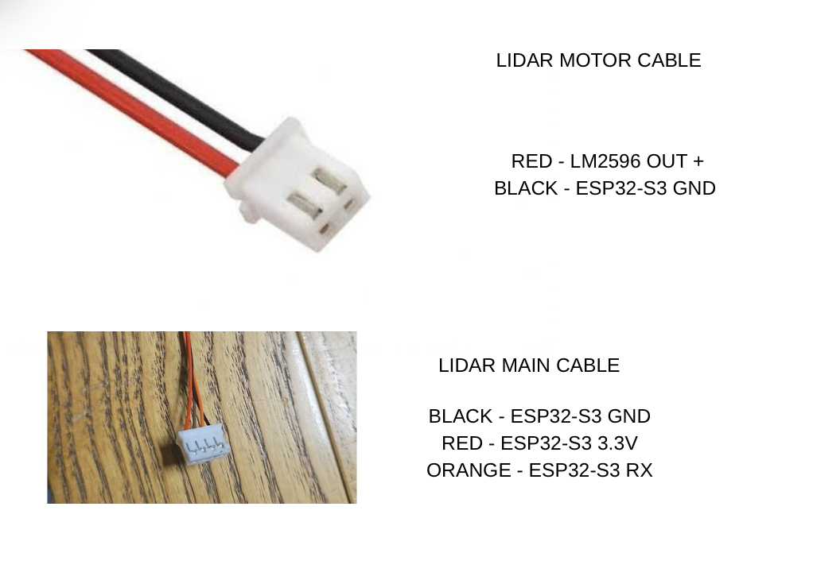
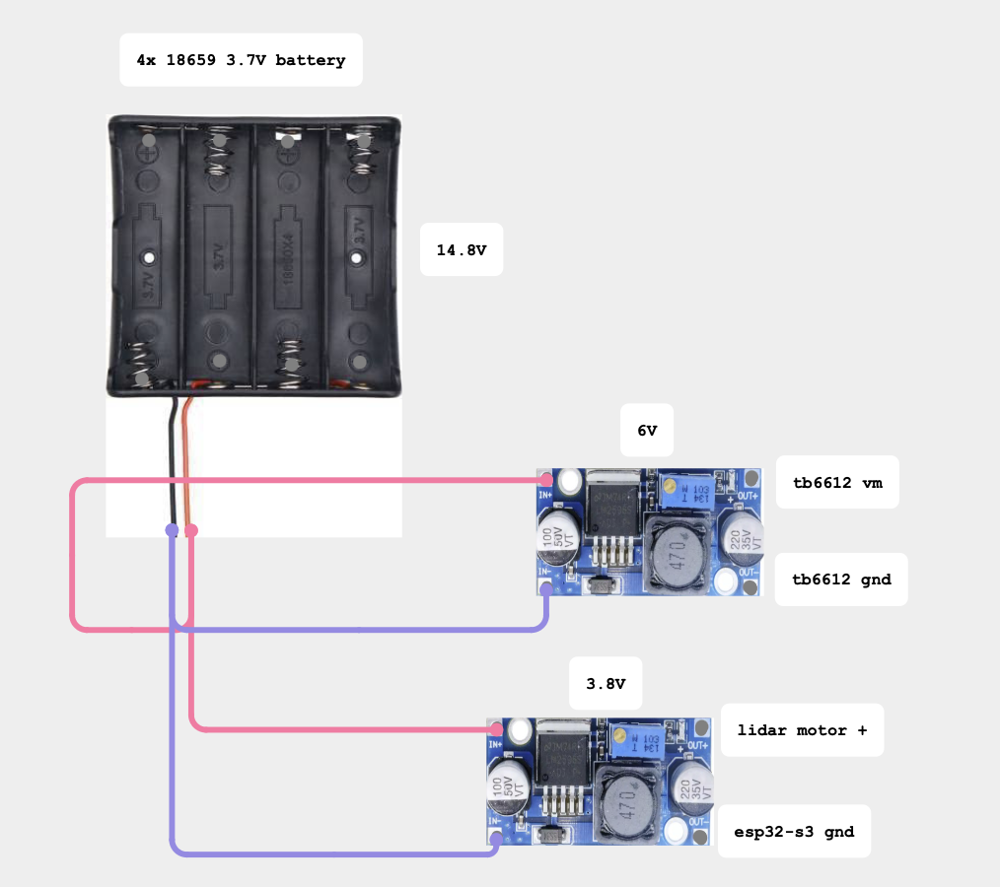
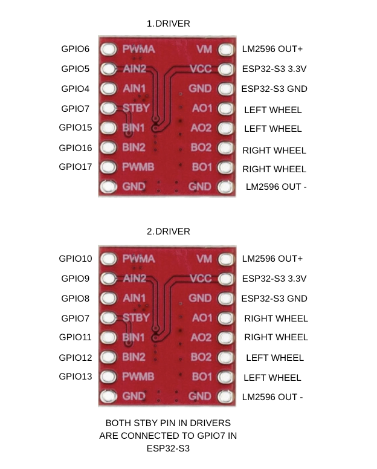

# System Architecture & Hardware Layout

```mermaid
flowchart TD
    subgraph Host ["Host Workstation (Ubuntu 22.04)"]
        UI["Tkinter GUI Control Panel"]
        ROS["ROS 2 Humble Bridge (/scan)"]
        SLAM["Cartographer ROS 2D SLAM (/map, TF)"]
        Planner["A* Grid Path Planner & Obstacle Avoidance"]
        
        UI <--> ROS
        ROS --> SLAM
        SLAM --> Planner
        Planner --> UI
    end

    subgraph Comm ["Wireless Communication"]
        UDP_M["UDP Port 4210: Motor Commands (V:l,r / M:dir)"]
        UDP_L["UDP Port 4211: Batched LiDAR Stream (22-byte packets)"]
    end

    subgraph Robot ["ESP32-S3 Rover"]
        ESP["ESP32-S3 Core & Watchdog (500ms)"]
        DRV1["TB6612FNG Driver #1 (Left Motors)"]
        DRV2["TB6612FNG Driver #2 (Right Motors)"]
        LIDAR["Vorwerk/Kobold VR100 LiDAR"]
        
        ESP -->|PWM / Direction| DRV1
        ESP -->|PWM / Direction| DRV2
        LIDAR -->|UART 115200 (GPIO 44 RX, 43 TX)| ESP
    end

    UI -->|Wi-Fi| UDP_M --> ESP
    ESP -->|Wi-Fi| UDP_L --> UI
```

---

## Hardware Power Distribution

The rover utilizes an isolated, multi-rail power architecture using two LM2596 buck converters and an independent USB power bank to protect logic circuits from motor inductive kickback:

1. **ESP32-S3 Logic:** Powered independently via a Baseus 10,000 mAh / 30 W USB power bank.
2. **Motor Driver Rail (TB6612FNG):** Stepped down via the first LM2596 buck converter from a 4S battery pack to ~6.0V.
3. **LiDAR Rail (VR100):** Stepped down via the second LM2596 buck converter to the sensor operating level (~3.8V discussed during bring-up; measure and verify before powering).
4. **Common Ground:** Logic, sensor, and driver ground lines are tied together to maintain a unified signal reference.

### Hardware Schematics & Wiring

| Component | Schematic / Diagram |
|---|---|
| **LiDAR Sensor Wiring** |  |
| **LM2596 Buck Converter Setup** |  |
| **TB6612FNG Dual Driver Wiring** |  |

---

## Key Integration Boundaries & Protocols

- **Transport:** Communication relies on UDP over Wi-Fi. Motor commands use `V:<left>,<right>` or discrete directional commands (`M:w`, `M:s`, `M:a`, `M:d`, `M:x`). LiDAR packets are batched (5 packets of 22 bytes per UDP datagram, 40 ms flush interval).
- **Sensing:** Raw LiDAR serial packets (`0xFA` sync byte + index + 4 data points + checksum) are validated on the ESP32 before transmission to reduce Wi-Fi traffic.
- **Coordinate Conventions:** Optical LiDAR rotation, robot frame (`base_link`), and ROS standard coordinate frames (`x` forward, `y` left, `z` up) are mapped inside the ROS 2 node.
- **Fail-Safe Mechanism:**
  - **Firmware watchdog:** Shuts off motor PWM if no valid UDP command is received within 500 ms.
  - **PC link monitor:** Warns the user and halts autonomous driving if network latency exceeds tolerance.
